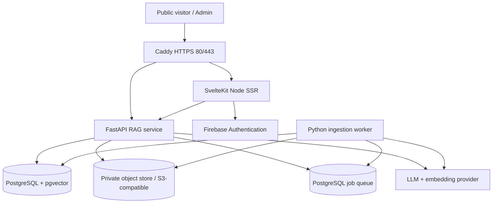

# PRD & Implementation Blueprint — KnowledgeOps AI

**Version:** 2.0 (VPS-first) · **Status:** Implementation-ready specification · **Date:** 2026-11-23  
**Repository:** `knowledgeops-ai` · **Product type:** Public showcase + protected admin workspace  
**Target:** Backend / AI Engineer / Fullstack · **Primary use case:** Technical documentation and incident-runbook RAG

## 1. Executive summary
KnowledgeOps AI is a retrieval-augmented generation (RAG) knowledge system for IT documentation, incident runbooks, system design notes, and public technical PDFs. It answers questions with verifiable passage-level citations, shows source documents and retrieval diagnostics, and provides an administrator-controlled ingestion pipeline. The public showcase uses curated documents and conservative usage limits; it never allows anonymous ingestion or access to private documents.

### Outcome / differentiation
- Production-style service boundaries: auth, ingestion, query, background jobs, database and evaluation.
- Real AI engineering: hybrid retrieval, citations, abstention, groundedness testing, cost/latency tracking and reproducible model settings.
- Portfolio-friendly: public read-only demo, architecture, evaluation report, integration tests and CI/CD, VPS-first production operation; optional serverless showcase.
- One project, independent GitHub repository; **not** bundled into InfraOps Lab.

## 2. Audience, roles, and use cases
| Role | Permissions | Jobs-to-be-done |
|---|---|---|
| Visitor (anonymous) | Query *published, public* collections only; low rate limit | Explore RAG with source citations |
| Admin (single Firebase UID allowlist) | Manage sources, ingestion, collections, experiments, evaluation | Operate and benchmark pipeline |
| Worker service account | Poll/claim allowed jobs and update indexed data | Parse, chunk, embed, reindex |

Primary journeys: (a) visitor asks how to debug a 503, receives cited procedural answer; (b) admin uploads approved PDF and watches ingestion status; (c) admin edits a document and new version replaces the old index atomically; (d) admin runs evaluation suite and compares retrieval/prompt configurations; (e) visitor asks unsupported question, system abstains with source-search suggestions.

## 3. Goals / explicit non-goals
**P0 goals:** public Q&A over seeded docs; PDF/MD/TXT import by admin; retrieval and clickable page/section citations; tenant/security separation; ingestion status; usage/cost accounting; CI/CD; reproducible local environment.

**P1 goals:** lexical + vector retrieval via reciprocal rank fusion; reranker behind flag; evaluation suite; feedback; versioning; streaming; operational metrics.

**P2 goals:** multi-user organizations, OCR, connectors, agent tools, multilingual advanced reranking, self-hosted embeddings. These are **not required** for MVP.

**Non-goals:** unrestricted web crawling, training own LLM, running heavy models on Vercel, giving executable shell commands with automatic execution, accepting arbitrary public uploads, providing a medical/legal authority, storing full private chats indefinitely.

## 4. Functional requirements and acceptance criteria
| ID | Priority | Requirement | Acceptance |
|---|---|---|---|
| K-01 | P0 | Public collections catalog | Anonymous only sees `visibility=public` and `status=published` |
| K-02 | P0 | Admin auth | Firebase ID token verified server-side; exact UID allowlisted; 401/403 tests |
| K-03 | P0 | Admin document import | PDF ≤15 MB (configurable), Markdown, TXT; MIME/signature check; SHA-256 dedup; safe filenames |
| K-04 | P0 | Async ingestion | Job statuses queued/running/succeeded/failed; bounded retries; unique job key |
| K-05 | P0 | Section/page chunks | Each chunk has document version, section/page and byte/token metadata |
| K-06 | P0 | Grounded answer | Answers reference valid retrieved chunk IDs; no fake citations; abstain if insufficient evidence |
| K-07 | P0 | Query API | Answer, citations, request ID, retrieval diagnostics (admin only), token usage and latency |
| K-08 | P0 | Rate limiting | Public per-IP/session quotas; admin quotas; provider spending cap — **exact numbers TBD**, must be set from real traffic/budget expectations (not assumed); fail-closed (503), not silent degrade, when cap exceeded |
| K-09 | P0 | Safe document lifecycle | Draft/reindex/publish/unpublish/archive; archived versions excluded from retrieval |
| K-10 | P0 | Observability | JSON logs, correlation ID, errors, provider timeouts, dashboard counters |
| K-11 | P1 | Hybrid search | Semantic and PostgreSQL full-text retrieval fused with RRF |
| K-12 | P1 | RAG evaluation | Fixed dataset with query, expected chunk IDs, rubric; Recall@5 and MRR; answer faithfulness via human/LLM judge |
| K-13 | P1 | Feedback | Thumbs up/down and optional issue code, no PII by default |
| K-14 | P1 | Prompt/model versions | Store pipeline config version on every answer and evaluation run |
| K-15 | P1 | Streaming | Stream text safely with citations sent as structured final event |
| K-16 | P1 | Usage | Tokens estimated or provider-reported, cost estimate, quota enforcement |
| K-17 | P1 | Coverage-gap report | Admin view aggregating abstained/low-confidence queries by frequency, to find missing docs (pattern: kapa.ai's gap analytics) |

### User stories
- As a visitor, I can select a public IT collection, ask a question, view cited snippets, and open the exact page/section.
- As an admin, I can import approved documents, track progress, retry failed import, and publish only when checked.
- As a reviewer, I can reproduce a benchmark using a recorded retrieval configuration, model ID and golden dataset.

## 5. Experience / UI specification
SvelteKit 5 + TypeScript + Tailwind. Responsive, pure dark default with optional light mode; restrained 60/30/10 color proportion. Pages:

1. `/`: showcase summary, architecture diagram, benchmark metrics, link to demo.
2. `/demo`: collections selector, sample questions, chat pane, sources drawer, safety notice, retry and clear session.
3. `/sources/[id]`: metadata, permitted document preview, page/section anchor, highlight cited chunks.
4. `/login`: Firebase Google sign-in for allowlisted admin (no signup workflow).
5. `/admin/documents`: upload, versions, ingestion timeline, visibility/publish controls.
6. `/admin/evaluations`: runs, Recall@K, MRR, answer-grounding score, latency, token/cost and config comparison; coverage-gap table of abstained queries (K-17) to spot missing docs.
7. `/admin/settings`: quotas, active model version, retrieval parameters (with validation), provider health.

Accessibility: keyboard controls, focus states, labels, color-contrast >= WCAG AA target, aria-live answer updates, reduced motion. UX: structured empty states, visible source restrictions, error retry messages; avoid rendering raw model HTML.

## 6. Architecture and deployment — VPS-first default

**Default production environment:** one Ubuntu LTS VPS with Docker Engine + Docker Compose v2, Caddy reverse proxy with automatic TLS, SvelteKit Node adapter, Python FastAPI, dedicated Python worker, PostgreSQL + pgvector, and private object storage. All containers except reverse proxy are reachable only over Docker networks; Postgres is not publicly bound. Optional Redis may be added later for distributed rate limiting/queues, but PostgreSQL-backed leased jobs are sufficient for MVP. DNS A/AAAA records point at VPS; firewall permits SSH from restricted addresses and 80/443 publicly. Container health checks, restart policies, persistent data, off-host backups and provider egress policy are mandatory.

**Frontend on Vercel + backend on VPS, with automatic demo-mode fallback:** SvelteKit deploys to Vercel (`adapter-vercel`) as the public-facing BFF; server-side code calls the VPS's publicly reachable FastAPI endpoint (behind Caddy) over HTTPS with a shared API key — never from the browser directly, so there's no cross-origin cookie/CORS problem to solve. On `/chat`, the BFF calls the VPS with a short timeout; on timeout or connection failure it serves a bundled fixture Q&A (`fixtures/demo-qa.json`, shipped with the Vercel build — same "example conversation, clearly labeled" pattern as `docs/mockups/mockup.html`) instead of erroring, with a visible `Demo mode — live backend unreachable` banner. A visitor never sees a fixture answer presented as a live one. This makes the public demo's *uptime* independent of the VPS; it does **not** make the VPS optional — a down VPS just means visitors silently get the canned fallback instead of real answers until it's back.

Admin routes (`/login`, `/admin/*`) have **no fallback** — they always require the live VPS; there's nothing useful an admin can do against stale fixture data, so a clear error is correct there, not a fake success.

Do not run the ingestion worker on Vercel. Managed Postgres and object storage can replace the VPS's self-hosted services without changing application contracts, but the VPS (or whatever runs FastAPI/Postgres) is still the source of truth — Vercel never originates or stores real data, only relays it or falls back to static fixtures.

**Suggested baseline sizing (planning estimate, benchmark before committing):** 2 vCPU / 4 GB RAM / 40 GB SSD for small curated datasets and API-based LLM/embeddings, with controlled concurrent ingestion; prefer 4 vCPU / 8 GB RAM if serving concurrent users or indexing many PDFs. These are estimates, not guarantees. Provision swap cautiously; monitor memory and disk capacity. Backups must not live solely on VPS disk.

**Boundaries:** public edge exposes only HTTPS (and HTTP redirect). Admin uses server-verified Firebase UID allowlist, protected ingestion. Never expose PostgreSQL, worker, Docker daemon, metrics or object-store administrative UI to Internet. Store originals in private object storage; for MinIO option bind API internally and provide time-limited gateway access or proxy signed downloads, with stable object keys and separate bucket policy. File bytes never execute. Set proxy max body and application upload limits consistently.


### Service boundaries
- **Web/BFF:** SvelteKit SSR, session cookie or Firebase ID token verification, public endpoint protections, response streaming.
- **RAG service:** Python FastAPI as the standard internal API behind the VPS proxy; SvelteKit acts as UI/BFF.
- **Worker:** Python 3.12+ with PyMuPDF/pdfplumber for text-first PDF parsing, chunker, embedding adapter, queue claim/heartbeat/retry. Run it as a **cron/systemd-timer-triggered one-shot** process (wake, claim and drain pending jobs, exit) rather than an always-resident daemon: ingestion is admin-only and infrequent, so an idle resident worker just holds ~100-200MB of Python + parsing libraries in RAM for nothing. The lease/heartbeat/`FOR UPDATE SKIP LOCKED` logic stays identical either way — only how the process is kept alive changes. Revisit a resident daemon only if ingestion volume/concurrency actually needs sub-minute pickup latency.
- **Data:** Postgres metadata, pgvector embeddings, full-text tsvector. Use one embedding dimension for a given index; dimension must match selected model.

### Query flow
1. Verify user + collection visibility; normalize request and enforce input length/quotas.
2. **Cache lookup** (before any paid call): compute `cache_key = hash(normalized_message, collection_id, collection_fingerprint, pipeline_version)`. On hit, return the stored answer/citations as-is (zero LLM/embedding cost), log a `query_events` row with `status='cache_hit'`, and skip to step 7. On miss, continue.
3. Embed query; filter eligible docs by collection and published version.
4. Retrieve top semantic and lexical matches; RRF fuse, optional rerank; select 4-8 chunks within token budget.
5. Assemble a strict context with stable chunk IDs, content and provenance; instruction hierarchy keeps source text untrusted.
6. Call LLM with timeout/retry budget; require structured citation IDs and abstention when evidence weak.
7. Validate citation IDs against retrieved set; strip invalid references; on a fresh (non-cached) answer, upsert it into `answer_cache` under the same key — abstained answers are cached too, since a question with no evidence will keep having no evidence until the corpus changes; save `query_events` and usage; stream response if enabled.

**Cache scope — exact match only, not semantic/"similar" match.** The key is the *normalized* question text (lowercased, trimmed, collapsed whitespace), not an embedding-similarity match. Two differently-worded questions can look alike by embedding distance but need different citations ("how do I restart service X" vs "how do I stop service X") — serving a fuzzy-matched cached answer would silently break the grounded-citation guarantee in K-06. A similarity-based cache is a real future optimization but needs its own correctness review (minimum similarity threshold, re-validating citations against the *actual* asked question) before it ships — don't build it opportunistically inside this feature.

**Invalidation:** `collection_fingerprint` is a value that changes whenever the collection's published document set changes (e.g. `max(documents.active_version_id update time)` or a counter bumped on every publish/archive) — this makes stale cache entries simply miss after a republish instead of needing an explicit purge.

**Interaction with K-17 (coverage-gap report):** gap frequency must count cache-hit replays of a previously-abstained question, not just fresh LLM abstentions, or repeat askers of the same unanswerable question will be undercounted.

### Ingestion flow
1. Admin requests signed upload URL; upload to private storage (avoid routing large uploads through application API).
2. Admin commits asset; server checks signature, size, hash, ownership, quota; creates version and idempotent queued job.
3. Worker claims one job transactionally (`FOR UPDATE SKIP LOCKED`), parses text and page/heading anchors; rejects encrypted or image-only PDFs in MVP.
4. Sanitize, remove repetitive headers if appropriate, chunk ~400-700 tokens with ~70-120 overlap; embedding in batches with bounded concurrency.
5. Insert chunks into staged version; validate nonempty chunks, embedding cardinality; transactionally mark version `ready`; admin publishes.
6. Publish flips active document version; queries filter published active versions only. Failed job preserves previous published version. Delete original and derived data according to retention policy.

## 7. Data schema (PostgreSQL)
`gen_random_uuid()` needs `pgcrypto` if required by database version. Adjust vector size to model **before** migration, for example `vector(768)`; model changes require re-embedding and possibly new table/index.

**Model pin — decision required before migration (TBD, not decided here):** pick one LLM provider/model and one embedding provider/model, confirm that embedding model's *exact* output dimension in its current docs, and set `vector(N)` to match — never assume 768 without checking. Both are swappable later only via a full re-embed, not a config flip.

**Embedding-model/dimension change procedure:** 1) add a new `chunks_v2`-style column or table with the new `vector(N)`; 2) worker backfills embeddings for all active versions under a new `pipeline_version`; 3) cut retrieval over once backfill completes and passes eval gate; 4) drop the old column/table. Never resize an in-place `vector` column with live traffic.

```sql
CREATE EXTENSION IF NOT EXISTS vector;
CREATE TABLE collections (
 id uuid PRIMARY KEY DEFAULT gen_random_uuid(), slug text UNIQUE NOT NULL,
 title text NOT NULL, description text NOT NULL DEFAULT '',
 visibility text NOT NULL CHECK (visibility IN ('public','private')),
 status text NOT NULL CHECK (status IN ('draft','published','archived')),
 created_at timestamptz NOT NULL DEFAULT now()
);
CREATE TABLE documents (
 id uuid PRIMARY KEY DEFAULT gen_random_uuid(), collection_id uuid NOT NULL REFERENCES collections(id),
 title text NOT NULL, source_type text NOT NULL, active_version_id uuid NULL,
 status text NOT NULL DEFAULT 'draft' CHECK (status IN ('draft','published','archived')),
 created_at timestamptz NOT NULL DEFAULT now()
);
CREATE TABLE document_versions (
 id uuid PRIMARY KEY DEFAULT gen_random_uuid(), document_id uuid NOT NULL REFERENCES documents(id),
 version_number int NOT NULL, object_key text NOT NULL, sha256 char(64) NOT NULL,
 mime_type text NOT NULL, bytes bigint NOT NULL,
 status text NOT NULL CHECK (status IN ('pending','processing','ready','failed')),
 error_code text, created_at timestamptz NOT NULL DEFAULT now(),
 UNIQUE(document_id,version_number)
);
ALTER TABLE documents ADD CONSTRAINT fk_active_version FOREIGN KEY(active_version_id) REFERENCES document_versions(id);
CREATE TABLE chunks (
 id uuid PRIMARY KEY DEFAULT gen_random_uuid(), version_id uuid NOT NULL REFERENCES document_versions(id) ON DELETE CASCADE,
 ordinal int NOT NULL, page_number int, heading text, content text NOT NULL,
 token_count int NOT NULL, embedding vector(768) NOT NULL,
 search_vector tsvector GENERATED ALWAYS AS (to_tsvector('english', content)) STORED,
 UNIQUE(version_id,ordinal)
);
-- No HNSW index at MVP scale: a curated seed corpus (low thousands of chunks)
-- scans fast enough exact (`ORDER BY embedding <=> $1`) without one, and exact
-- search can't miss the true top-k the way an approximate index can — citation
-- accuracy matters more than ANN speed here. HNSW's graph also costs real RAM,
-- which is scarce on a 1-2 vCPU/2GB VPS. Add it back only after benchmarking
-- shows sequential scan is actually too slow for the real corpus size, not on
-- a guessed chunk-count threshold.
CREATE INDEX chunks_search_gin ON chunks USING gin(search_vector);
CREATE TABLE ingestion_jobs (
 id uuid PRIMARY KEY DEFAULT gen_random_uuid(), version_id uuid NOT NULL REFERENCES document_versions(id),
 idempotency_key text NOT NULL UNIQUE, state text NOT NULL CHECK(state IN ('queued','running','succeeded','failed','dead')),
 attempts int NOT NULL DEFAULT 0, locked_until timestamptz, error_code text,
 created_at timestamptz NOT NULL DEFAULT now(), updated_at timestamptz NOT NULL DEFAULT now()
);
CREATE TABLE answer_cache (
 id uuid PRIMARY KEY DEFAULT gen_random_uuid(), cache_key char(64) NOT NULL UNIQUE,
 collection_id uuid NOT NULL REFERENCES collections(id), question_text text NOT NULL,
 pipeline_version text NOT NULL, answer jsonb NOT NULL,
 hit_count int NOT NULL DEFAULT 0, created_at timestamptz NOT NULL DEFAULT now(),
 last_hit_at timestamptz
);
CREATE INDEX answer_cache_collection_idx ON answer_cache(collection_id);

CREATE TABLE query_events (
 id uuid PRIMARY KEY DEFAULT gen_random_uuid(), collection_id uuid NOT NULL REFERENCES collections(id),
 actor_hash text, pipeline_version text NOT NULL, model_id text NOT NULL,
 latency_ms int, input_tokens int, output_tokens int, estimated_cost_usd numeric(12,6),
 status text NOT NULL, created_at timestamptz NOT NULL DEFAULT now()
);
CREATE TABLE feedback (id uuid PRIMARY KEY DEFAULT gen_random_uuid(), query_id uuid NOT NULL REFERENCES query_events(id),
 rating smallint NOT NULL CHECK(rating IN (-1,1)), reason_code text, created_at timestamptz DEFAULT now());
CREATE TABLE evaluation_runs (id uuid PRIMARY KEY DEFAULT gen_random_uuid(), config jsonb NOT NULL,
 dataset_version text NOT NULL, metrics jsonb, status text NOT NULL, created_at timestamptz DEFAULT now());
```

**Important:** never expose raw `chunks` or `documents` tables to anonymous SQL clients; all access is server-side and scoped to permitted collection and active version. Database migration should add triggers or transaction checks so `active_version_id` always belongs to the same document. In production use separate runtime/worker roles, least-privilege privileges, and retention jobs. Connection pooling (e.g. PgBouncer) is not needed on the default VPS path — SvelteKit/FastAPI hold a small stable pool each — but becomes necessary if the query path moves to serverless functions (§6 alternate mode), since each invocation opens its own connection and can exhaust `max_connections` fast.

## 8. API contract (v1)
Prefix `/api/v1` on SvelteKit endpoints. Uniform error: `{ "error": { "code": "...", "message": "...", "requestId": "..." } }`. Authenticate admin routes with verified Firebase session/ID token; public routes remain limited.

| Method | Route | Access | Purpose |
|---|---|---|---|
| GET | `/collections` | Public | Published public collections |
| GET | `/collections/:slug/sources` | Public | Published source metadata |
| POST | `/chat` | Public | Answer and citations; throttled |
| POST | `/chat/stream` | Public | SSE `delta`, `citations`, `usage`, `done` |
| POST | `/feedback` | Public + abuse protection | Record feedback for valid query |
| GET | `/health` | Public | Lightweight liveness only |
| GET | `/admin/collections` | Admin | All collections incl. draft/private |
| POST | `/admin/collections` | Admin | Create collection (draft) |
| PATCH | `/admin/collections/:id` | Admin | Edit metadata/visibility/status |
| GET | `/admin/documents` | Admin | Documents and versions |
| POST | `/admin/documents/upload-url` | Admin | Signed upload target with constraints |
| POST | `/admin/documents/commit` | Admin | Commit asset, enqueue ingestion |
| POST | `/admin/documents/:id/publish` | Admin | Atomic publish of ready version |
| POST | `/admin/documents/:id/archive` | Admin | Disable retrieval |
| GET | `/admin/jobs/:id` | Admin | Job status and failures |
| POST | `/admin/jobs/:id/retry` | Admin | Retry only retryable job |
| POST | `/admin/evaluations` | Admin | Start bounded evaluation job |
| GET | `/admin/evaluations/:id` | Admin | Metrics and comparison |
| GET | `/admin/usage` | Admin | Usage metrics, quota and cost |
| GET | `/admin/coverage-gaps` | Admin | Abstained/low-confidence queries, grouped by frequency (K-17) |

Example `POST /chat`:
```json
{"collectionSlug":"network-runbooks","message":"How should I investigate a 503 upstream timeout?","history":[],"clientRequestId":"req_abc123"}
```
Example response:
```json
{"answer":"Check upstream health and traces first [1].","citations":[{"marker":1,"chunkId":"<uuid>","documentId":"<uuid>","title":"API Gateway Runbook","page":3,"excerpt":"..."}],"requestId":"req_abc123","usage":{"inputTokens":450,"outputTokens":38},"grounded":true,"cacheHit":false}
```

### Key error cases
`400` invalid content/length; `401` unauthenticated admin; `403` wrong UID/collection; `404` nonexistent or invisible; `409` duplicate version/conflict; `413` oversize upload; `422` unparseable/encrypted PDF; `429` quota; `503` model provider unavailable. Avoid leaking source existence through differing error messages.

## 9. Security, safety, privacy
- Public curated corpus only; uploads admin-only, files private by default; no anonymous upload or arbitrary URL fetch (SSRF).
- Firebase Admin SDK verifies signature, issuer, audience, expiry and allowed UID; `ADMIN_UIDS` stored only server-side; deny by default.
- Admin session: Firebase client SDK silently refreshes the ID token in-browser; server verifies the token fresh on every protected call (no server-side session cache of trust). A `401` on an expired/invalid token redirects the admin UI to `/login`; no silent retry with stale credentials.
- API keys, DB credentials, storage signing credentials in deployment secrets; never `PUBLIC_` variables, commits, browser bundles or job logs.
- Uploaded PDF filename is metadata, not file path; validate magic bytes, MIME, max length, content count; scan malware where supported; disable script processing; reject suspicious PDFs.
- Enforce token budget, max history, prompt injection handling: document text is *data*, cannot change system instructions; never expose internal prompt/secrets.
- Rate limit with central durable store, not in-memory function state; cost budget and circuit-breaker; safe bounded model timeouts.
- Query event stores hashed actor identifier and counts; opt-in transcript storage only; redact secrets and potential personal data in logs.
- Data deletion must cascade chunks/embeddings after removing published references; retention: public session contents not persisted by default, query usage events 30 days configurable.
- Supply-chain: dependency locks, Dependabot/Renovate, secret scan, SBOM optional, minimal GitHub token permissions.
- Ensure citations refer to source visible to the user; avoid quote hallucinations by checking citation chunk IDs; disclose generated answers may be incorrect.

## 10. Evaluation & SLOs

### Seed corpus (real documents, license-checked — not fixtures)
Public demo collections must use real documents with a clear, checked license; never assume a document is reusable. Candidates below were license-verified before listing here:

| Document | Fits as | License | Source |
|---|---|---|---|
| NIST SP 800-61 Rev. 2 — Computer Security Incident Handling Guide | incident runbook | Public domain (US government work) | https://csrc.nist.gov/pubs/sp/800/61/r2/final |
| CISA Federal Government Cybersecurity Incident and Vulnerability Response Playbooks | incident runbook | Public domain (US government work) | https://www.cisa.gov/sites/default/files/2023-02/Federal_Government_Cybersecurity_Incident_and_Vulnerability_Response_Playbooks_508C.pdf |
| Kubernetes official docs | technical documentation | CC BY 4.0 (attribution required) | https://kubernetes.io/docs/ |
| PostgreSQL official docs | technical documentation | PostgreSQL License (permissive, attribution appreciated) | https://www.postgresql.org/docs/ |

Google's SRE Book/Workbook (CC BY-NC-ND 4.0) was considered and **excluded by default**: NC-ND forbids redistributing derivatives, which chunk-and-reindex arguably is — don't ingest it without a separate legal check. Record the license and source URL per document in its metadata; never ingest a document with unknown or incompatible licensing, public demo or not.

Create curated `eval/datasets/network-runbooks-v1.jsonl` with at least **30** annotated questions (answerable, ambiguous, unanswerable, prompt injection), drawn from the seed corpus above. Split a small set held out from prompt tuning. Each row: `id`, `question`, `collection`, `relevant_chunk_ids`, `expected_facts`, `should_abstain`, `risk_tag`.

| Metric | Method | MVP acceptance target (not claimed result) |
|---|---|---|
| Recall@5 | Gold relevant chunks vs top 5 retrieved | ≥0.80 on curated held-out questions |
| MRR@10 | Reciprocal first relevant rank | ≥0.65 |
| Citation validity | Cited IDs exist in retrieved context | 100% |
| Unsupported-answer abstention | Held-out unanswerable questions | ≥0.90 |
| Groundedness | Human scoring (min 20 cases), optional model judge | ≥0.85 |
| p95 API latency | 100 warmed sequential/low-concurrency queries | ≤8 s (depends on provider) |
| Ingestion reliability | Retry tests, 20 documents | ≥95% success for supported formats |
| Security | Auth, unauthorized collection, quota tests | 100% passing |

Report dataset, sample size, model ID, embedding model, chunk dimensions, cache state and cost. Compare vector-only baseline against hybrid; don't assert wins without measurements.

## 11. Implementation architecture / package structure
```text
knowledgeops-ai/
  apps/web/                     # SvelteKit frontend and BFF API
    src/routes/(public)/        # Landing, demo, cited source viewer
    src/routes/admin/           # Protected admin UI
    src/routes/api/v1/          # Auth, chat, documents, evaluation endpoints
    src/lib/server/             # auth, db, rate-limit, storage, ai gateway
  services/rag/                 # Python package: retrieval, prompting, citation validator
  services/worker/              # Python ingestion worker, retries, heartbeat
  packages/contracts/           # JSON Schema + generated TS/Python types
  database/migrations/          # Versioned SQL migrations
  eval/datasets/                # Golden QA and retrieval datasets
  eval/scripts/                 # Evaluation and plotting
  infra/compose.yaml            # VPS/default app + API + worker + pgvector + proxy
  infra/                         # Deployment config and runbooks
  docs/adr/                     # Architecture decision records
  docs/ARCHITECTURE.md
  docs/THREAT_MODEL.md
  docs/RUNBOOK.md
  .github/workflows/ci.yml
  .github/workflows/ingest.yml  # Protected, manually approved batch import
  .env.example
  README.md
```

### Module interfaces (Python)
```python
class Embedder(Protocol):
    async def embed_documents(self, texts: list[str]) -> list[list[float]]: ...
    async def embed_query(self, text: str) -> list[float]: ...
class Retriever(Protocol):
    async def retrieve(self, query: str, collection_id: str, limit: int) -> list["ChunkHit"]: ...
class Generator(Protocol):
    async def answer(self, query: str, context: list["ChunkHit"]) -> "GroundedAnswer": ...
```
Implement provider adapters as explicit injectable interfaces; mock them during tests. Make chunk creation deterministic, with idempotent reindex and separate `pipeline_version`.

### Retrieval SQL sketch
```sql
SELECT c.id, c.content, 1 - (c.embedding <=> $1::vector) AS similarity
FROM chunks c
JOIN document_versions v ON v.id=c.version_id
JOIN documents d ON d.active_version_id=v.id AND d.status='published'
JOIN collections col ON col.id=d.collection_id AND col.status='published'
WHERE col.id=$2 AND col.visibility='public'
ORDER BY c.embedding <=> $1::vector LIMIT 20;
```
For private admin collection retrieval use **a different authorized query path** that explicitly checks admin; do not strip the public visibility predicate naively. Hybrid retrieval uses tsvector `@@ websearch_to_tsquery(...)`, ranks with `ts_rank`, then merges independently ranked lists using RRF (`1/(60+rank)`). Index performance/tenant isolation must be benchmarked; filter selectivity can affect approximate index recall.

## 12. CI/CD & deployment implementation (default VPS)
- Pull requests: Svelte checks, Python Ruff/type checks/tests, migration validation, pgvector integration tests, secret/dependency checks; no production secrets for fork PRs.
- Build: immutable version tags and image digests for web, API, worker; multi-stage Dockerfiles, non-root runtime, vulnerability scan, SBOM optional. CI must never run untrusted code on a production self-hosted runner.
- Deployment: protected `main` release workflow requires approval; push images to GHCR; production VPS pulls a **pinned image tag/digest**, applies **backward-compatible database migrations** with backup and dry-run checks, `docker compose up -d` with health checks, smoke test, then record image digests and commit SHA. Prefer SSH deploy user with limited sudo/permissions; GitHub secrets for SSH key, known_hosts pinning, and registry read token. Never expose the Docker socket or SSH key to the public app.
- Rollback: restore previous app image digests first (expand/contract schema). Database restore is a separate, tested, explicitly approved destructive action, not an automatic rollback side effect.
- Observability: structured JSON logs, bounded log rotation, `/health/live` and `/health/ready`, external uptime checks, latency/error-rate monitoring, disk/memory/DB storage/queue-depth/worker lag alerts, LLM quotas and spend alarms. Administrative metrics must not be open publicly.
- Vercel deploy: the SvelteKit BFF, with its shared API key for the VPS as a Vercel env var (never `PUBLIC_`); the build also ships `fixtures/demo-qa.json` for the demo-mode fallback (§6). Deploy previews never get production secrets or the real API key — preview builds run in fixture-only mode.


### Required env vars
`DATABASE_URL`, `FIREBASE_PROJECT_ID`, `FIREBASE_CLIENT_EMAIL`, `FIREBASE_PRIVATE_KEY`, `ADMIN_UIDS`, `LLM_API_KEY`, `EMBEDDING_API_KEY`, `STORAGE_BUCKET`, `STORAGE_SIGNING_CREDENTIALS`, `RATE_LIMIT_STORE_URL`, `PUBLIC_DEMO_DAILY_QUOTA`, `PIPELINE_VERSION`. Never commit actual values; `.env.example` uses placeholders only.

## 13. Milestones / task breakdown
**M0 — Foundations (days 1-3):** monorepo, architecture ADRs, SvelteKit app, Python modules, Postgres migrations, local Docker, fixture seeds, CI baseline. Exit: green build + migrations in clean DB.

**M1 — Ingestion (days 4-8):** signed upload; metadata/version tables; PDF/MD parser; deterministic chunking; embedding batching; job leases/retries; duplicate detection; publish transaction. Exit: 3 supported docs ingested + version switch + failing PDF produces safe error.

**M2 — RAG (days 9-13):** embedding query, filtered vector retrieval, prompt templates, citation validator, public demo UI, quotas and provider timeouts. Exit: curated benchmark runs; unsupported response abstains; no invisible citations.

**M3 — Quality (days 14-19):** keyword search + RRF, held-out eval, usage metrics, feedback, rate limit load tests, admin evaluation dashboard. Exit: acceptance gates met or documented deviations.

**M4 — VPS deployment & showcase (days 20-24):** provision hardened VPS, DNS/TLS, build and deploy Compose images, set up the cron/timer-triggered ingestion worker, configure persistent volumes and off-site backups, monitoring and rollback; deploy the SvelteKit BFF to Vercel pointed at the VPS API, verify the demo-mode fallback actually triggers when the VPS is unreachable. Exit: 15-minute reviewer flow works without admin credentials.

Time estimates are planning targets only. Optimize scope if provider cost or free tiers constrain testing.

## 14. Test plan
- **Unit:** tokenizer/chunker overlap; provider failures; RRF ranks; citation validator; quota; prompt serialization; hash/dedup.
- **Integration:** Postgres migrations; retrieval visibility; delete/archive; job race/lease recovery; ingestion replay exactly-once effect; concurrent publish.
- **E2E:** public query -> cited answer -> source preview; admin upload -> status -> publish -> query; throttling; admin wrong UID.
- **Security:** fake ID token, expired token, insecure object key, malicious HTML, prompt injection sample, oversized input, private collection enumeration.
- **Load:** 20 concurrent chat queries within provider cap; document ingestion at bounded concurrency; assert no unbounded connection pool growth.

## 15. Definition of done / demonstration script
- A new developer can run a local smoke test from README without live paid model calls by using deterministic mock provider.
- Public demo works with a curated public collection, citations and graceful rate limits.
- Real-provider mode is opt-in by environment configuration with budget cap; no API key exposed to browser.
- Evaluation script writes reproducible JSON report and documents model/config/cost.
- Protected administration and published/private boundaries pass automated tests.
- CI checks, deployment runbook, ADR decisions, screenshots, limitations and observability dashboard are documented.

**Portfolio proof:** 2–3 minute screencast; architecture diagram; sample API curl; screenshots of citations, jobs, eval; test coverage; measured metrics. Clearly differentiate mocked demo data from measured real-provider results.

## 16. Risks & mitigations
| Risk | Mitigation |
|---|---|
| LLM/API costs | Daily quota, canned public prompts, budget guard, caching, off switch |
| Model hallucinations | Citation validation, abstention, eval, supported-answer only policy |
| Index drift | Embedding model/version pin; staged reindex; migration plan |
| Serverless timeouts | Offload ingestion; signed direct-to-storage uploads; bound retrieval |
| PDF parser errors | Explicit supported-format policy, reject encrypted/scanned PDFs; failure diagnostics |
| Tenant data leak | Server-side visibility filters, integration and permission tests |
| Dependency/platform changes | Pin versions, recheck Vercel limits and provider TOS before launch |

## 17. Official references
- pgvector indexing: https://github.com/pgvector/pgvector
- Vercel Functions limits: https://vercel.com/docs/functions/limitations
- GitHub Actions security: https://docs.github.com/en/actions/security-for-github-actions
- Firebase ID token verification: https://firebase.google.com/docs/auth/admin/verify-id-tokens


## 18. VPS operational specification (mandatory for default release)

### Environments and secrets
| Environment | Execution | Data policy | Release |
|---|---|---|---|
| `dev` | Local Compose | Synthetic documents | Manual build |
| `staging` | Separate VPS or isolated Compose project, distinct DB/bucket | Public fixtures only | Pre-production smoke |
| `production` | Hardened VPS Compose | Private originals, limited public collections | Approved pinned release |
| `showcase-vercel` (optional) | Static/demo frontend | Synthetic or permitted read-only public content | Independent deploy |

Use `.env.production` created on VPS with mode `0600`, never included in image or Git. Secrets include `POSTGRES_PASSWORD`, session encryption, provider keys, Firebase Admin credentials, private object-store credentials, and admin UID. Firebase Admin credentials should be a mounted secret file; avoid exposing raw newline keys in client-accessible variables. Rotate/revoke on compromise. Do not log access tokens, prompt contents containing confidential text, presigned URLs or raw document bodies.

### Security, networking and authentication
1. Harden host: supported security updates, non-root SSH account, SSH keys only, disable password/root SSH login after verification, UFW/nftables allow 80/443 and restricted SSH, fail2ban optional, time sync.
2. Caddy receives 80/443 and routes `/api/*` to internal FastAPI and other paths to Node SSR. Configure trusted proxy headers and upstream timeouts; apply security headers, HSTS after TLS proven, CORS allowlist, upload size cap and per-IP abuse control.
3. Only `web`, `api`, `worker`, `db` communicate via private networks with least-privilege DB roles. Use an internal-only DB network and no database host port. Readiness checks must fail if required DB migration/config invalid.
4. Enforce collection ACLs in the API **and SQL filters**, source version ownership checks and no direct anonymous database access. Admin Firebase token is verified on server for each protected call.
5. Uploaded PDFs: MIME/signature and size validation, filename normalization, isolated parsing process with resource/time limits; sanitize extracted text before presentation; treat retrieved content as untrusted input. Use immutable object keys and quotas.

### Recovery, scaling, and SLO
- Database: daily `pg_dump` custom format plus an explicit tested restore schedule; for stricter RPO, implement WAL/PITR with suitable storage/monitoring. Copy encrypted backups to a different provider/bucket with retention (e.g. daily 7, weekly 4) and restore tests at least monthly. Define actual RPO/RTO only after exercising a recovery drill. Document encryption keys separately from archive.
- Object store: protect originals with versioning/backup or lifecycle copy, test object + database consistency after restore. Mark orphaned blobs for reconciliation rather than unsafe immediate deletion.
- Deploy: `docker compose config --quiet`, image digest verify, migration lock, health checks, synthetic citation query, rolling-safe or short maintenance window; capture release metadata and explicit rollback command.
- Capacity: monitor worker backlog and `pgvector` index size. One VPS is a single failure domain; document downtime and migration to separate managed Postgres/worker before claiming high availability. Scale API and worker separately only when measured.
- Release gate: TLS valid, 80 redirects to 443, DB/MinIO/Grafana not exposed, upload+ingest+query with citations works end-to-end, private collection isolation test passes, backup remote verified and restore rehearsal recorded, smoke checks green.

### Implementation paths
- `infra/compose.yaml`, `infra/Caddyfile`, `infra/.env.example`, `docs/DEPLOY_VPS.md` for default VPS operations.
- `infra/compose.dev.yaml` for local override as needed.
- `.github/workflows/ci.yml`, `release.yml` with manual approval and pinned image promotion.
- `apps/web/Dockerfile`, `services/rag/Dockerfile`, `services/worker/Dockerfile`, migrations + ops scripts are required application artifacts during implementation, **not included as finished runtime in this documentation package**.
